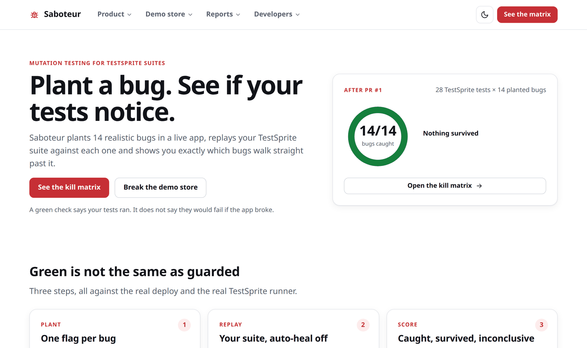
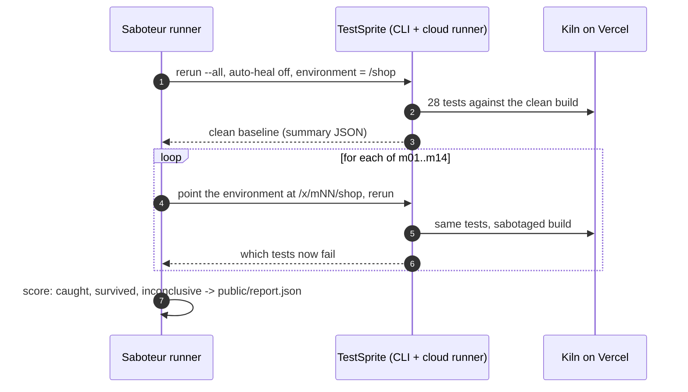
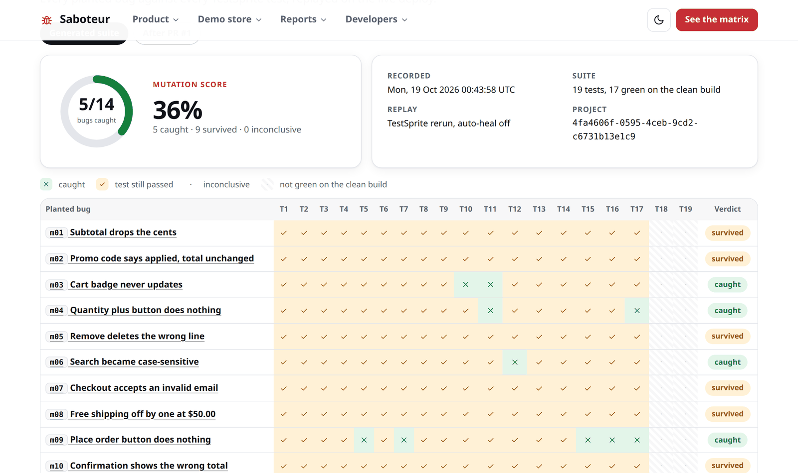
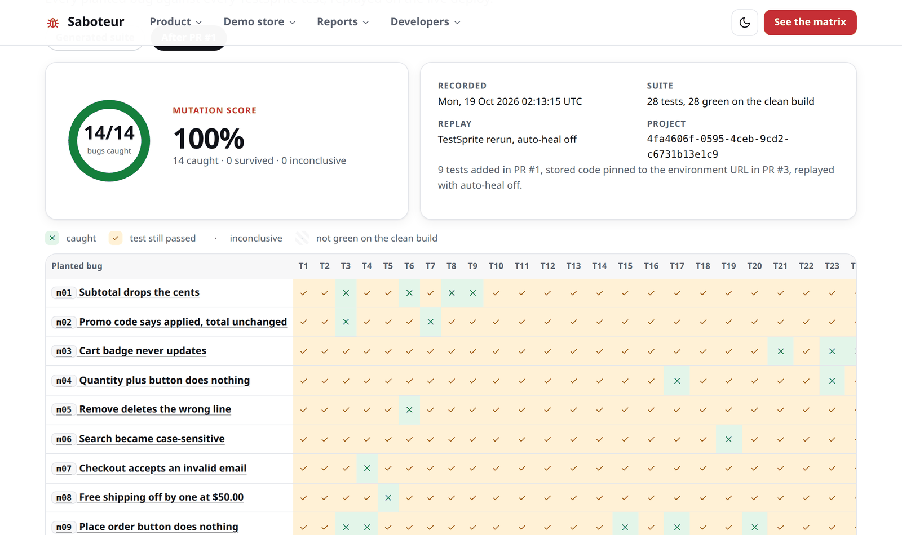
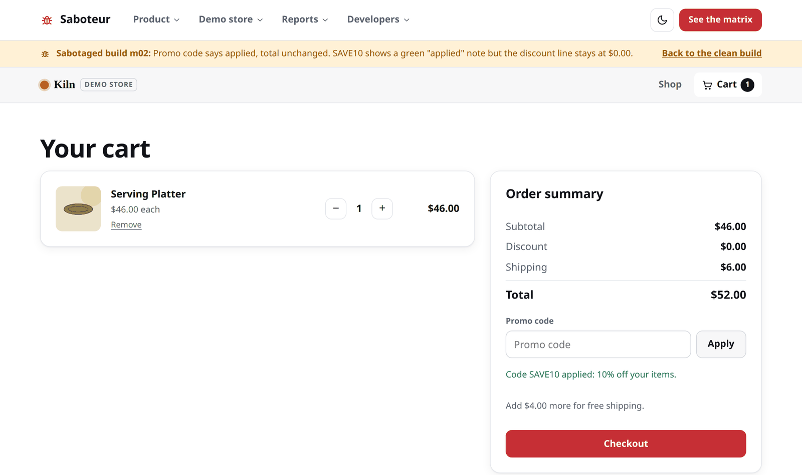
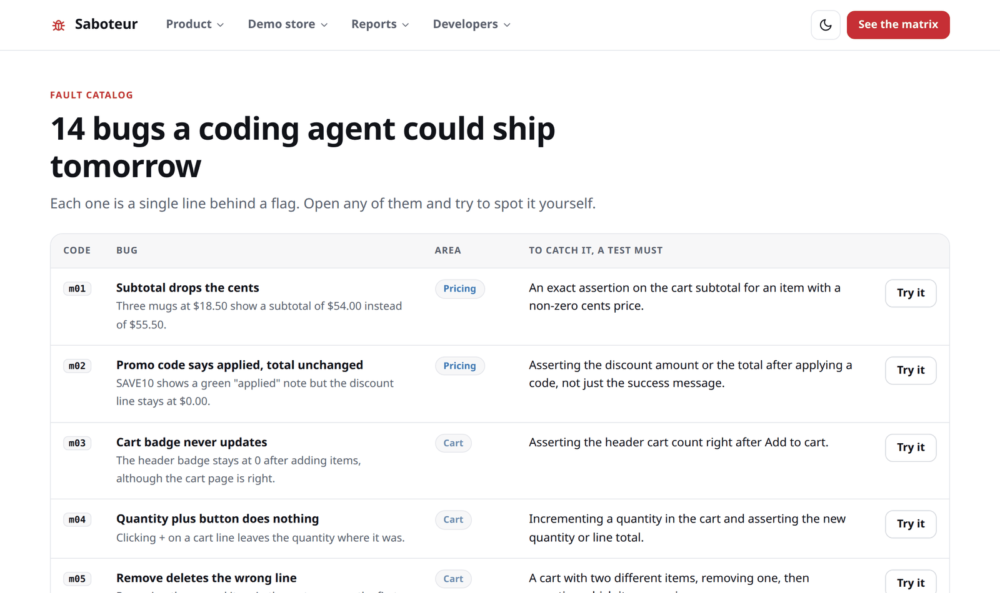
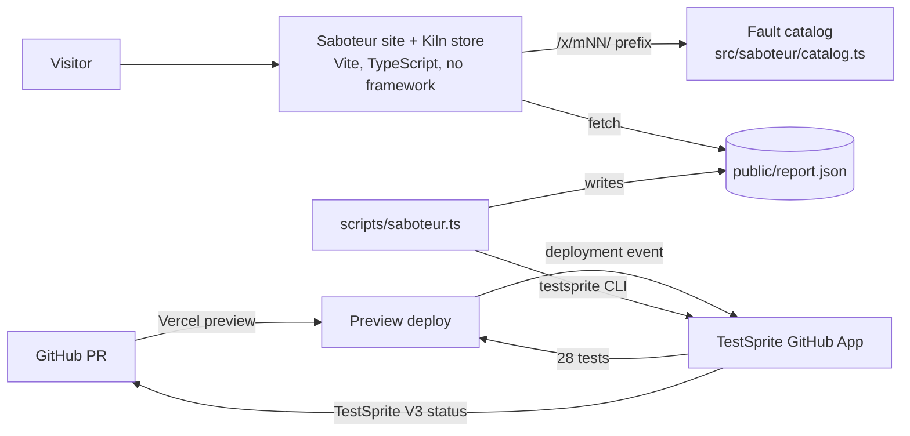

<!-- SPDX-License-Identifier: LicenseRef-zkasuran-SAND-1.0 -->
<p align="center">
  <picture>
    <source media="(prefers-color-scheme: dark)" srcset="docs/assets/banner-dark.svg">
    
  </picture>
</p>

<p align="center">
  <a href="https://saboteur-cyan.vercel.app"><b>Live demo</b></a> ·
  <a href="#try-it-in-60-seconds">Try it</a> ·
  <a href="#how-it-works">How it works</a> ·
  <a href="#the-pr-trail">The PR trail</a> ·
  <a href="#what-the-suite-covers">What the suite covers</a> ·
  <a href="SECURITY.md">Security</a>
</p>

<p align="center">
  
  
  
  
  
</p>

---

**Saboteur is mutation testing for a TestSprite suite.** It plants 14 realistic bugs in a live store behind a URL
flag, replays the TestSprite suite against each sabotaged build with auto-heal off and shows which bugs walk
straight past it. TestSprite's generated suite of 19 tests was all green and caught **5 of 14**. One PR later, the
suite catches **14 of 14** and TestSprite blocks any PR that ships one of those bugs.

> **Why now.** A green check says the tests ran, not that they would fail if the app broke. The Season 4 page quotes
> it directly: *"It generated 40 tests. Three were the ones I needed."* Saboteur tells you which three.

<p align="center">
  <picture>
    <source media="(prefers-color-scheme: dark)" srcset="docs/assets/hero-dark.png">
    
  </picture>
</p>

## Try it in 60 seconds

Open **[saboteur-cyan.vercel.app](https://saboteur-cyan.vercel.app)**.

| | Do this | You will see |
|---|---|---|
| 1 | Click **See the kill matrix** | Every planted bug against every TestSprite test. Switch tabs to compare the generated suite (5/14) with the suite after PR #1 (14/14). |
| 2 | Open **Product → Fault catalog**, then **Try it** on m02 | The store with the promo bug planted. Add the Serving Platter, apply `SAVE10`: "applied", yet the discount stays $0.00. |
| 3 | Click **Back to the clean build** and repeat | The same steps take $4.60 off. One deploy, two behaviours, chosen by the URL. |
| 4 | Open [PR #2](https://github.com/zkasuran/saboteur/pull/2) | A deliberate pricing bug. TestSprite failed it (23/28) and GitHub refused the merge. |

## How it works



1. **One flag at the line the bug lives on.** `sab.isOn("promo-ignored")` sits exactly where a real regression would. Clean builds never take the branch.
2. **One address per bug.** The prefix `/x/m01/` to `/x/m14/` turns a fault on for every page under it. Codes are opaque, so an AI tester cannot read the bug from the URL.
3. **Replay with auto-heal off.** With healing on, an agent can rewrite a failing test to fit the bug, so the bug is never reported. The runner only accepts strict replays.
4. **A bug is caught** when a test that passed on the clean build fails on the sabotaged one. Survivors are the next tests to write.

<table>
  <tr>
    <td width="50%"><picture><source media="(prefers-color-scheme: dark)" srcset="docs/assets/before-dark.png"></picture><p align="center"><sub><b>Before.</b> The generated suite: 5 of 14 caught.</sub></p></td>
    <td width="50%"><picture><source media="(prefers-color-scheme: dark)" srcset="docs/assets/report-dark.png"></picture><p align="center"><sub><b>After PR #1.</b> 14 of 14, each by the test written for it.</sub></p></td>
  </tr>
  <tr>
    <td width="50%"><picture><source media="(prefers-color-scheme: dark)" srcset="docs/assets/sabotaged-dark.png"></picture><p align="center"><sub><b>A sabotaged build.</b> m02: the promo says applied, the total does not move.</sub></p></td>
    <td width="50%"><picture><source media="(prefers-color-scheme: dark)" srcset="docs/assets/faults-dark.png"></picture><p align="center"><sub><b>The fault catalog.</b> What each bug does and what a test must assert to catch it.</sub></p></td>
  </tr>
</table>

## The PR trail

TestSprite's GitHub App runs all 28 tests on every PR's Vercel preview and reports as the `TestSprite V3` status
check. `main` is protected: the check must pass, admins included.

| PR | What it did | TestSprite on the PR |
|---|---|---|
| [#1](https://github.com/zkasuran/saboteur/pull/1) | 9 tests for the 9 survivors, then the receipt fix | `50cf9c0` 27/28: a generated test wanted a shipping picker Kiln never had. `fc8da26` 27/28: **"Confirmation charges the cart total" failed**, the receipt showed only the total. `caed1f3` **28/28** after the receipt itemised subtotal, discount and shipping. Merged. |
| [#2](https://github.com/zkasuran/saboteur/pull/2) | A deliberate regression: unit prices rounded down to whole dollars | **Failed 23/28, merge blocked.** All 5 tests that caught it came from PR #1; the generated suite alone would have let it through. Closed unmerged. |
| [#3](https://github.com/zkasuran/saboteur/pull/3) | Pinned the stored test code (see findings) and published matrix 2 | 28/28. Merged. |

## What we found about TestSprite suites

Measured on this project, with run ids in `runs/` and the report.

| Finding | Evidence |
|---|---|
| A green generated suite caught 5 of 14 realistic bugs | Matrix 1: 19 tests, all passing fresh. Survivors included a wrong subtotal, a promo that does not discount, an invalid email accepted and a wrong confirmation total. |
| 2 of 19 generated tests could not pass a strict replay of a correct build | One drove the sort dropdown with `select_option("")`; one asserted the quantity stepper as the text `"− 1 +"`. |
| A generated test invented a feature | "...updated quantity and shipping selection" asked to pick a shipping option. Kiln has one flat rate. TestSprite's fix prompt suggested restoring the selector. |
| PR runs with auto-heal pinned the preview URL into stored code | After the PR #1 and #2 runs, 28 of 28 tests opened an absolute `saboteur-git-…` preview URL instead of `VAR_{url}`, so every later replay ignored its environment: all 14 sabotaged builds scored an identical 21/28. |
| Auto-heal weakened an assertion | The healed receipt test checked only that "Order placed" and "Receipt" appeared. Every exact amount the plan required was gone. |

The fix is in [`testsprite/code/`](testsprite/code): hand-written code for the nine survivor tests with exact
`data-testid` assertions, plus the generated tests repaired by [`scripts/repair_code.py`](scripts/repair_code.py).
Each hand-written test was run locally against the clean build (pass) and its own sabotaged build (fail) before
upload. The stored code was checked again after the next PR run.

## What the suite covers

28 frontend tests in the TestSprite project, run against the live store on every PR.

| Area | Tests include | Exact assertions include |
|---|---|---|
| Catalog | browse, search, clear search, sort (2), product page (3), continue shopping | lower-case search finds the mug; price sort puts Spoon Rest first and Serving Platter last |
| Cart | add from shop and product page, update quantity, remove (2), reload, sold out, shipping totals | subtotal $55.50 for three $18.50 mugs; removing Planter leaves Bud Vase at $14.75; cart survives reload |
| Pricing | promo, free-shipping boundary, subtotal cents | SAVE10 on $46.00 gives -$4.60 and $47.40; exactly $50.00 ships free, $25.00 pays $6.00 |
| Checkout | required fields, invalid email, valid checkout, proceed to checkout | `not-an-email` stays on checkout with a field error |
| Confirmation | order placed (3), receipt totals | receipt lists $18.50, -$1.85, $6.00 and charges $22.65 |

The plan for each added test is in [`testsprite/plans/`](testsprite/plans).

## What is real and what is simulated

| Real | Simulated |
|---|---|
| TestSprite project, 28 tests, every run and PR check (run ids in `runs/`, links on the PRs) | Kiln is a demo store: nothing is sold, charged or shipped (said on every store page) |
| The deploy on Vercel and its per-PR previews | Orders live only in your browser's `localStorage` |
| The 14 bugs, planted in the shipped code and reached by URL | The bugs are written by us, so the catalog is known to the tests added in PR #1 |
| Both kill matrices, replayed on TestSprite with auto-heal off | |

## Architecture



## Run it locally

```bash
git clone https://github.com/zkasuran/saboteur && cd saboteur
npm ci
npm run dev            # http://localhost:5173, faults at /x/m01/shop ... /x/m14/shop
./verify.sh            # the full gate, ends with ALL GREEN
```

## Runner quickstart

Needs Node 22.18 or later (the runner is TypeScript run by Node's type stripping) and the official CLI. The API
key goes to the CLI through the environment, never through argv; the runner never reads it.

```bash
npm i -g @testsprite/testsprite-cli
read -rs TESTSPRITE_API_KEY && export TESTSPRITE_API_KEY && testsprite setup --from-env --no-agent -y && unset TESTSPRITE_API_KEY

P=<project-id>; O=https://<your-app>
node scripts/saboteur.ts run    --project $P --origin $O --label "My suite" --single-env   # one environment, repointed per fault
node scripts/saboteur.ts report --project $P --origin $O --label "My suite"                # validates, scores, appends to public/report.json
```

On plans with more than one environment, `node scripts/saboteur.ts envs --project $P --origin $O` creates one per
fault and `run` without `--single-env` replays them two at a time. Cost: one strict frontend replay is 0.5 credits,
so a 28-test matrix (clean plus 14 faults) is about 210 credits.

## Built to be attacked

See **[SECURITY.md](SECURITY.md)** for the threat model.

- **Fault codes are validated, never looked up raw.** Anything but `m` plus two digits from the catalog is a 404 view.
- **Browser storage is hostile input.** Size cap, guarded parse, every cart line re-checked against the catalog; 500 rounds of random bytes in the tests.
- **The report is validated in full** before render. A run recorded with auto-heal on is rejected.
- **Strict CSP** generated at build time (`default-src 'none'`, script by hash), `frame-ancestors 'none'`, HSTS, nosniff.

```bash
./verify.sh    # tsc strict, 41 unit + adversarial tests, runner self-check, report validation,
               # build with CSP, headless Chrome e2e (13 routes, both themes, 390 and 1360 wide,
               # zero console or CSP errors, clean flow + 11 bugs reproduced), npm audit
```

## Repository

```
src/saboteur/catalog.ts   the 14 faults, URL parsing, the isOn() switch
src/shop/                 Kiln: pricing, cart and checkout rules (integer cents), validated storage
src/report/               kill-matrix scoring and report validation, shared with the runner
src/views/                site pages and store pages
scripts/saboteur.ts       matrix runner over the TestSprite CLI
scripts/write_tests.py    hand-written TestSprite code for the survivor tests
scripts/repair_code.py    repairs for generated TestSprite code
scripts/e2e.mjs           headless Chrome checks used by verify.sh
testsprite/plans/         plan files for the tests added in PR #1
testsprite/code/          the code TestSprite replays
runs/                     TestSprite summaries behind both matrices
public/report.json        the published matrices
```

## Roadmap

- [x] 14 planted faults, store, kill-matrix report, runner
- [x] TestSprite on every PR, blocking, with a red-then-green PR and a blocked regression
- [x] Matrix 1 (5/14) and matrix 2 (14/14) published with run ids
- [ ] Faults that change server responses, not just the frontend
- [ ] Generate candidate faults from a diff, so each PR is checked against bugs near the code it touched
- [ ] Re-run suspicious cells with `testsprite test flaky` before counting a kill

## Licence

Source-Available No-Derivatives Licence 1.0: [`LicenseRef-zkasuran-SAND-1.0`](LICENSE).
